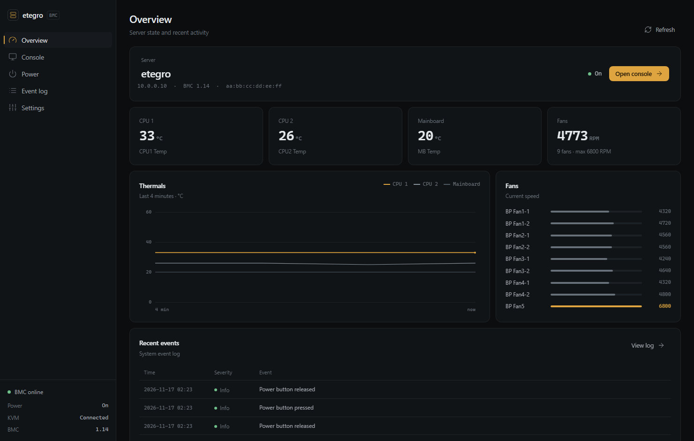

# etegro BMC panel

Local control panel for an Inspur/Quanta **ESMS** BMC: power, sensors, event
log and a live KVM console, without the old Java 7 applet.

Python backend, small HTML/CSS/JS interface, native window through pywebview.
The video codec is the BMC's own 32-bit decoder; `setup.py` downloads it from
your BMC and fetches a matching Temurin 8 x86 JRE from Adoptium.



## Features

- **Overview** — power state, CPU/mainboard temperatures, fans, a live thermals
  chart and the latest SEL entries.
- **Console** — live 1024×768 KVM, keyboard capture, absolute mouse,
  Ctrl Alt Del, screenshots, fullscreen.
- **Power** — on, graceful shutdown, reset, power cycle, force off, and the
  next boot device.
- **Event log** — full SEL, newest first.
- **Settings** — BMC address, user, server MAC, video quality, KVM reconnect,
  BMC cold reset.

## Requirements

- Windows 10/11 (the vendor decoder is a 32-bit Windows DLL).
- Python 3.10+ with `flask`, `pillow`, `pywebview`, `pyghmi`:

  ```powershell
  python -m pip install flask pillow pywebview pyghmi
  ```

- Network access to the BMC. The BMC jar is served without a login; the
  password is only needed for IPMI and the KVM login.

## Setup

```powershell
cd app
python setup.py --host 10.0.0.10
```

`setup.py`:

1. downloads `JavaRSM.jar` from `https://<bmc>/lib/rsm/JavaRSM.jar`;
2. extracts `libWindowsVDecode.dll` from it into `vendor/`;
3. downloads the Temurin 8 x86 JRE (~37 MB) into `runtime/`;
4. writes `app/config.json` with the BMC address, user and server MAC.

The MAC is read from the ARP cache when possible, otherwise it asks. The BMC
uses it for the KVM login, so it must match the server.

Set the BMC password once per user:

```powershell
setx ESMS_PASS "your-bmc-password"
```

The password is read from `ESMS_PASS` (environment or the user registry) and is
never written to disk.

## Run

```powershell
cd app
.\start.ps1
```

- `.\start.ps1` — native window
- `.\start.ps1 -Browser` — browser on `http://127.0.0.1:8765/`
- `.\start.ps1 -Console` — run in the terminal for diagnostics

`start.ps1` runs `setup.py` automatically when `runtime/` or `vendor/` is
missing.

## Command line

IPMI without the GUI:

```powershell
python tools\esmsctl.py power status
python tools\esmsctl.py sensors
python tools\esmsctl.py sel
python tools\esmsctl.py bmc reset
```

It reads the BMC address from `app/config.json` or `-b/--bmc` and the password
from `ESMS_PASS`. Requires `pyghmi`.

## How it works

- **IPMI** — pyghmi over UDP 623. One long-lived session per process
  (`keepalive=False`); some BMCs reject or hang on rapid session churn.
- **KVM control** — TCP 8890, login with an md5-crypt password and the server
  MAC; heartbeat every 5 s.
- **Video** — TCP 8900. Frames are a custom 32-byte header followed by a
  command/Huffman stream, not standard JPEG.
- **Decoder** — `decoder/DecoderServer.java` loads the vendor DLL and keeps one
  `VideoController` alive, so partial frames and RC4 state work. It returns
  BGR, 3 bytes per pixel. The Python side converts frames to MJPEG for the UI.
- **Input** — 8-byte HID reports: keyboard `0x8100`, absolute mouse `0x8200`
  after switching the console to absolute mode (`0x8202`).

## Limitations

- The video decoder is the BMC's own 32-bit codec. It is **not** included in
  this repository: `setup.py` downloads it from the BMC you own. Do not
  redistribute vendor firmware.
- Virtual media (ISO redirection over TCP 9000) is not implemented yet.
- The BMC allows one KVM session. Close other JavaRSM windows if the console
  does not connect.
- If the video daemon wedges (console connects but no frames arrive), use
  **Settings → Cold reset BMC**. The host keeps running; the BMC is back in
  about 90 seconds and the panel reconnects.
- Windows only for now. Supporting Linux would need the 32-bit Linux decoder
  and a different JRE.

## Design

The interface follows [unslop](https://github.com/heydamir/unslop) by
[@heydamir](https://x.com/heydamir) (CC BY 4.0): quiet graphite chrome, one
amber accent, monospace telemetry, the live KVM screen as the single bright
element, and a status rail plus keycaps as the signature.

## License

The panel code is MIT licensed; see `LICENSE`. Vendor artifacts downloaded by
`setup.py` remain under their owners' terms and are not part of this project.
